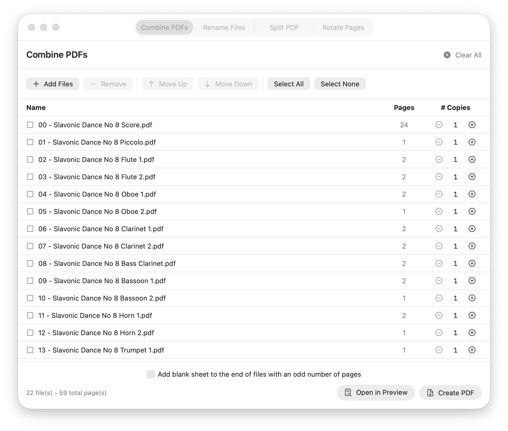
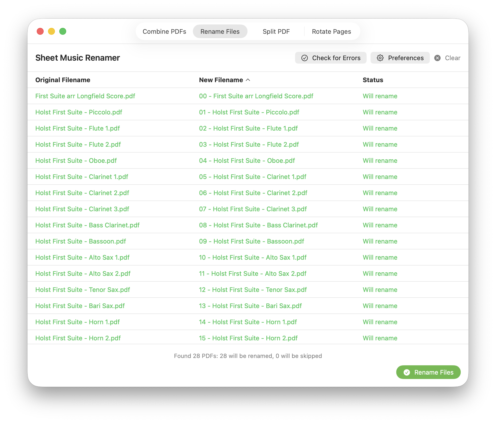
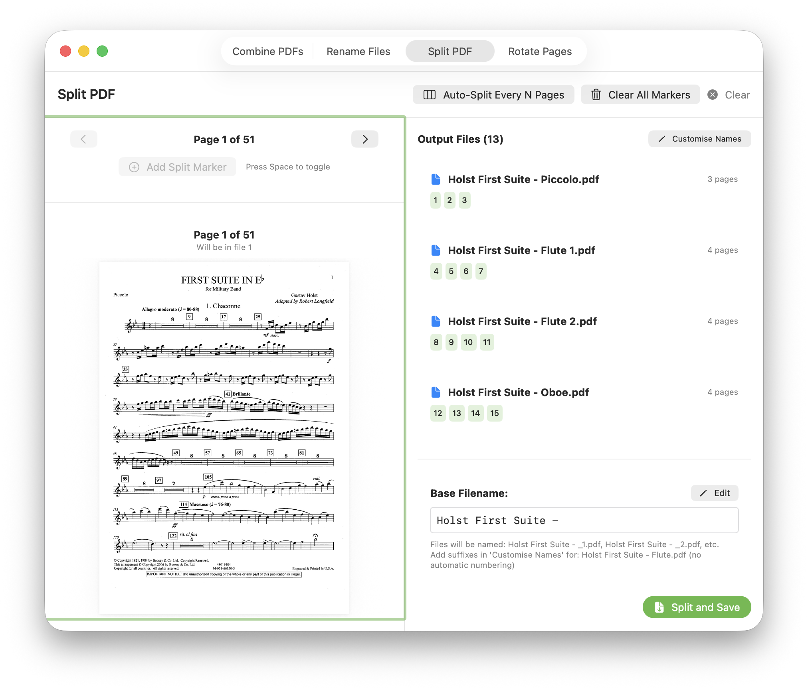
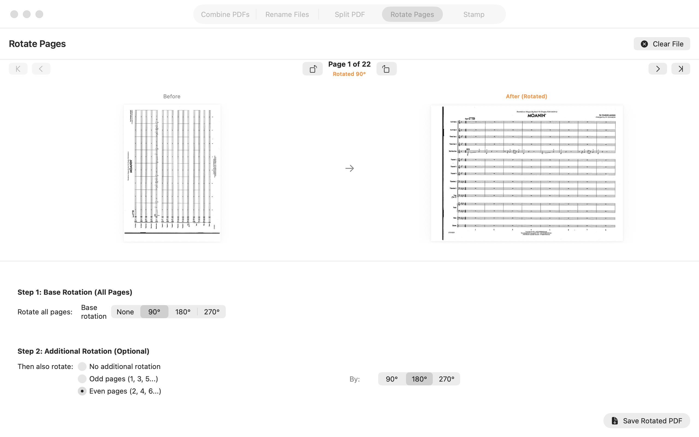
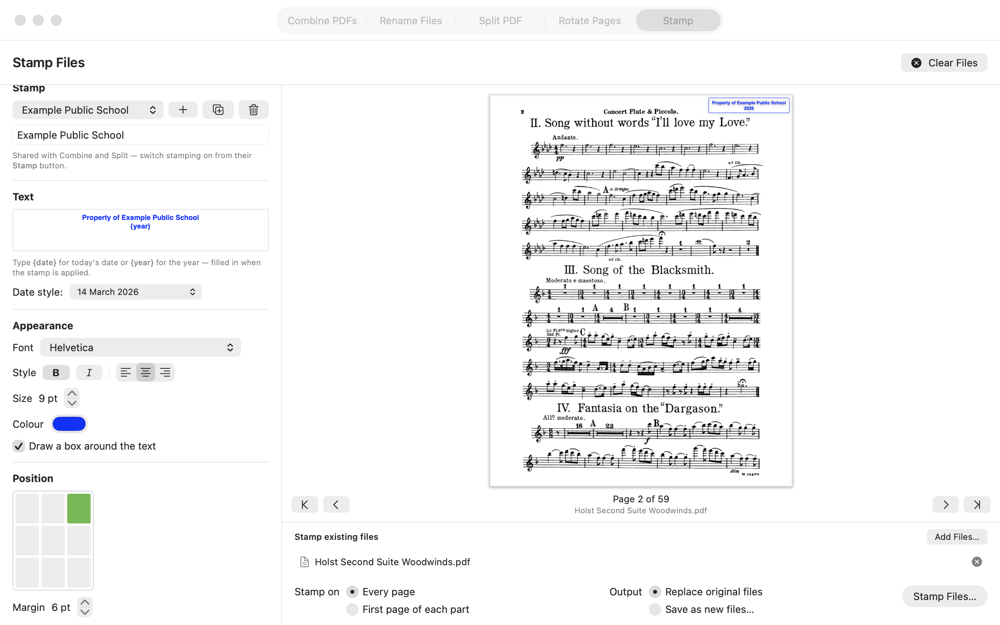

# ScoreSort

[](https://github.com/benperche/ScoreSort/actions/workflows/tests.yml)

A powerful macOS application for managing music PDFs with five tools for musicians and music librarians: PDF combining with smart copy management, automatic file renaming and bulk part renaming, PDF splitting with smart instrument naming, page rotation, and stamping parts with your ensemble's mark.

## Features

### 📎 PDF Combiner
Combine multiple PDF files into a single document with flexible copying and page management.

- **Drag-and-drop or browse** to add PDF files or images (JPEG, PNG, TIFF, HEIC, BMP, GIF); multi-frame TIFFs appear as a single entry with the correct page count
- **Add blank pages** — insert a blank A4 page at any position in the list
- **Quick Look** — press `Space` to preview the selected file without leaving the app; arrow keys step through the other parts
- **Specify copies** for each file (great for printing multiple parts)
- **Collate groups** — select files and press `C` to create a group whose copies are printed *interleaved*: 4 copies of [Perc 1, Perc 2, Timpani] → P1, P2, T, P1, P2, T, … ready to hand out by player
- **Reorder files** with Move Up/Down buttons; groups always move as a unit
- **Ensemble Presets** — save named instrument lists (Wind Band, Jazz Band, Orchestra, or your own) with per-part copy counts; drag in files, click "Apply to Files" and copy counts are set automatically
- **Smart preset matching** — handles roman-numeral filenames (Violin I/II → matches Violin 1/2 preset parts) and single-file consolidation (one Flute.pdf against Flute 1 + Flute 2 in preset → summed copies)
- **Smart blank pages** — automatically add blank sheets after odd-page files for double-sided printing
- **Automatic table of contents** — the combined PDF includes bookmarks for each file, visible in Preview's sidebar; multiple copies are labelled "Filename 1/3", "Filename 2/3", etc.
- **Open in Preview** — opens combined PDF in Preview for a quick check (⇧⌘P)
- **Print** (⌘P) — straight to the system print dialog, no saving first
- **Booklets** — impose every part as its own fold-and-staple saddle-stitch booklet, on A3 or on
  A4 landscape, with an adjustable page scale. macOS has no booklet feature of its own
- **Or save to file** — create a permanent combined PDF document
- **Selection tools** — Select All, Select None, Remove selected files
- **Live preview** — see total file and page counts as you build

### 📁 Sheet Music Renamer
Two tools in one tab for organising sheet music filenames.

**Score Order Sorter** (drag a folder onto the left side)
- **Automatic instrument detection** from existing filenames
- **Sequential numbering** (Score = 00, instruments start at 01)
- **Three ensemble presets**: Wind Band, Jazz Band, and Orchestra
- **Customisable instrument order** — edit, reorder, add, or remove instruments in Preferences
- **Manual override** for files that can't be auto-detected
- **Error checking** — rescan already-numbered files to find and fix mistakes
- **Smart detection** — handles "bass clarinet" vs "clarinet" correctly
- **Live preview** — see all changes before executing

**Bulk Part Renamer** (drag a folder onto the right side)
- **Rename files from scratch** — ideal for downloads from IMSLP or scan batches with unhelpful names
- **Set a base name** shared across all files (e.g. *Beethoven Symphony 5*)
- **Smart instrument autocomplete** — suggestions ordered by likely ensemble position, with cross-instrument and numbered progression
- **Page crop preview** — zoomed view of each file's first page with a minimap so you can see exactly where you're looking on the page
- **Optional score-order prefix** — toggle to apply sequential numbering in one extra step

### ✂️ PDF Splitter
Split a large PDF — for example a complete scan of all parts bound together — into separate instrument files.

- **Visual page preview** with keyboard navigation (including first/last page jumps)
- **Click-to-toggle split points** directly on the page strip
- **Auto-split by stride** — split every N pages with a single click
- **Bookmark-aware loading** — if the PDF was produced by ScoreSort's combiner, split points and file names are pre-populated automatically from the embedded table of contents
- **Three-step workflow** — Step 1: mark split points; Step 2: name each output file; Step 3 (optional): apply score-order prefix numbering
- **Smart naming stage** — zoomed-in crop of each file's first page shows the instrument name corner, with a minimap overlay so you can orient yourself on the page
- **Instrument name autocomplete** — suggestions drawn from all ensemble presets, ordered by what's most likely to come next; automatically advances to the next instrument family (e.g. "Oboe 1" after "Flute 2")
- **Arrow-key dropdown navigation** — ↓/↑ moves through suggestions without leaving the keyboard; Return accepts, Escape dismisses
- **Filename validation** — illegal characters (/ : \\) flagged inline before saving
- **Base filename** shared across all output files; per-file suffix appended automatically
- **Skip pages or whole files** — press Delete (or the Skip button) to exclude individual pages or entire output files from the saved result; toggle between page-skip and file-skip mode with the segmented control
- **Swap with Next** — rearrange adjacent output files without changing split markers
- **Split Double Pages** — scans with two pages side by side (A3 sheets, or an overhead/book scanner's mix of spreads and single pages) are offered for splitting on load. A review sheet shows every scan: two-page scans are cut at the gutter between the pages (or where the black scanner bed starts), single pages are left whole, and black or empty pieces are marked to skip. Drag a cut line to move it, switch a scan between one and two pages, or click a piece to skip or keep it; choose whether the left or right page comes first. Scans of identical sheets (e.g. flatbed A3) start in **Same cut on every page** mode: every page is cut down the middle — drag any cut to move them all — so they can be split in one go. Skipped pages stay in Step 1, greyed out. Only the crop boxes change, so scan quality is untouched, and rotated pages are handled. If auto-detection doesn't fire, use **Fix Scan ▸ Split Double Pages…**
- **Fix Booklet Order** — if your scan is a saddle-stitched booklet scanned sheet-by-sheet (cover first or inner-first), ScoreSort can automatically reorder the pages into reading order. Once a file segment has a page count divisible by 4, click **Fix Booklet Order** in the toolbar (or the stack icon on a file card). Large page thumbnails let you choose the correct reordering; a custom drag-to-reorder fallback is also available. After applying, the **Redo** button (⬚▶) on any matching file card applies the same order instantly

### 🔄 Page Rotator
Rotate PDF pages with flexible options for whole-document and per-page corrections.

- **Base rotation** for all pages (90°, 180°, 270°)
- **Additional rotation** for odd or even pages only — useful for double-sided scans with alternating orientations
- **Individual page rotation** — rotate just the current page left or right without affecting others
- **Before/after preview** for each page
- **Perfect for fixing scanned documents** with mixed or incorrect orientations

### 🔖 Stamp
Mark parts as your ensemble's — "Property of Example School Band" — the way you'd use a rubber stamp.

- **Design and save any number of stamps**, one per school or ensemble
- **Rich text**: set the font, size and colour, and bold or italic just the words you choose
- **Place it anywhere** — nine quick positions, or drag the stamp around on a live preview of your own page
- **`{date}` and `{year}` placeholders** filled in when the stamp is applied, for "this copy made on…" copyright lines (day-first dates by default)
- **Stamp files you already have** — PDFs and images, a folder at a time, replacing the originals or saving copies under names you choose
- **Or stamp as you go** from the Combine and Split tabs, on every page or just the first page of each part
- **Burned into the page**, so it prints everywhere and can't be deleted out of the PDF

### 🤖 Use it from an AI assistant

- **Ask an AI to do the job** — "split this scan into parts, name them and number them in score order" — and it uses ScoreSort to do it, with the same results as the app
- **Command line** for AI tools with a terminal (Claude Code, Codex and the like) and for scripts
- **MCP server** for AI chat apps (e.g. the Claude desktop app)
- See [Using ScoreSort with AI](#using-scoresort-with-ai)

## Screenshots


*Quickly create arbitrary copies of a number of files ready for printing*


*Automatic sheet music file renaming with instrument detection*


*Split PDFs with visual preview and custom naming*


*Rotate pages with before/after preview*


*Design a stamp and apply it to parts*

## Installation

### Requirements
- macOS 14.0 (Sonoma) or later

### Download

1. Download the latest `ScoreSort.dmg` from the [Releases](https://github.com/benperche/ScoreSort/releases) page
2. Open it and drag **ScoreSort** into your **Applications** folder
3. Open ScoreSort from Applications. macOS asks once whether to open an app downloaded from the internet — click **Open**. (ScoreSort is signed and notarised by Apple.)

ScoreSort updates itself after that. Keep it in Applications — that's also where AI assistants connected to it expect to find it.

### Building from Source

1. Clone the repository:
```bash
git clone https://github.com/benperche/ScoreSort.git
```

2. Open `ScoreSort.xcodeproj` in Xcode 26 or later

3. Press ⌘R to build and run

## Usage

### PDF Combiner

1. **Add files**
   - Drag and drop PDFs or images (JPEG, PNG, TIFF, HEIC, BMP, GIF) onto the window
   - Or click "Add Files" to browse
   - Click "Add Blank Page" to insert a blank A4 page after the selected file

2. **Set copy counts** for each file
   - Use + / − buttons, or double-click the number to type directly
   - The status bar at the bottom shows running totals

3. **Reorder files** (optional)
   - Select files and use "Move Up" / "Move Down" buttons, or ⌘↑ / ⌘↓
   - Files will be combined in the order shown

4. **Create collate groups** (optional — for interleaved multi-part printing)
   - Select 2 or more files and click **Collate** or press `C`
   - A group header row appears showing the shared copy count for the whole set
   - When combining, the group repeats N times interleaved — e.g. 4 copies of [Perc 1, Perc 2, Timpani] produces Perc 1, Perc 2, Timp, Perc 1, Perc 2, Timp, … ready to hand out one stack per player
   - Double-click the copy count to type it directly
   - Click the ↗ button on the header to dissolve the group back to individual files

5. **Apply an Ensemble Preset** (optional — auto-sets copy counts for each part)
   - Click the **Presets** button or press `P` to open the preset sidebar
   - Choose a preset from the dropdown (Wind Band, Jazz Band, Orchestra, or any you've saved)
   - Click **Apply to Files** — copy counts are matched to the preset's parts automatically
   - Files with no matching preset part are highlighted in orange
   - Preset parts with no matching file are also highlighted in orange in the sidebar
   - Create and edit presets in **Preferences** (⌘,) → Combiner tab

6. **Choose the output layout** (optional) — the menu at the bottom left
   - **Single pages** (default): one page per sheet side, in reading order. "Blank page after
     odd-length parts" ensures each new part starts on the front of a sheet when printing double-sided
   - **Booklet**: every part is imposed as its own fold-and-staple booklet — two pages to a sheet
     side in saddle-stitch order, padded to a whole folded sheet. See [Booklets](#booklets) below

7. **Output your combined PDF**
   - Click "Print…" to send it straight to the printer
   - Or "Open in Preview" to create a temporary PDF and check it first
   - Or "Create PDF" to save as a permanent file

#### Booklets

macOS has no booklet option of its own — where you see one it comes from a printer driver, and
AirPrint queues never have it. ScoreSort therefore does the imposition itself and prints an
ordinary two-up PDF, so a whole band folder goes out in **one** print job rather than one
document at a time. Each part (and each *copy* of a part) becomes its own foldable booklet.

- **Sheet size** — *Double size* puts A4 parts onto A3 paper at full size; *Fit A4 landscape*
  scales two pages onto A4, giving an A5 booklet that prints on any printer
- **Scale** — published music rarely matches A4 exactly, so this sizes each page within its half
  of the sheet: 100% fits it exactly, higher fills more of it, lower leaves more space around the music

**Printing from ScoreSort.** Setting up your printer, once. macOS does not let an app choose
your two-sided setting, so:

1. Choose **Set Up Two-Sided Printing…** from the output menu
2. It prints one numbered sheet. Make sure **Double-sided** is set to *On* in the print dialog
3. Fold the sheet: if the pages read **1, 2, 3, 4** all the right way up, you're done. If they
   don't, say so and ScoreSort switches the setting for you and offers another test sheet

The answer is remembered **per printer**, so home and school can each keep their own.

> **The print dialog's preview may show every second side upside down.** That's normal — it's how
> the sheet has to be sent so it comes out the right way up once the printer turns the paper over.
> Judge it by what comes out of the printer, not by the preview.

If your printer has no two-sided mode, print the odd pages, put the stack back in, and print the
even pages using **Paper Handling** in the print dialog.

**Exporting a PDF to print later.** The flip depends on the printer, so ScoreSort only applies it
when *it* is doing the printing. **Create PDF** and **Open in Preview** always give a booklet that
reads the right way up on screen — an ordinary file you can check, keep, email, or carry to
whatever printer you end up at. Whoever prints it, wherever, needs only: print it **double-sided**,
choose whichever two-sided setting brings the backs out the right way up, then fold and staple.
The page order is already sorted.

#### Keyboard Shortcuts (Combiner)
| Key | Action |
|-----|--------|
| `↑` / `↓` | Select previous / next file |
| `⇧↑` / `⇧↓` | Extend selection up / down |
| `⌘A` | Select all files |
| `⌫` | Remove selected files |
| `⌘↑` / `⌘↓` | Move selected files up / down |
| `C` | Group selected files into a collate set |
| `Space` | Quick Look the selected file |
| `P` | Toggle Presets panel |
| `⌘P` | Print the combined PDF |
| `⌘T` | Booklet page turns (in Booklet output) |
| `⇧⌘P` | Open the combined PDF in Preview |
| `⌘Z` / `⌘⇧Z` | Undo / Redo |

---

### Sheet Music Renamer

#### Score Order Sorter

1. **Drag a folder** onto the **left side** of the Rename Files tab
2. **Choose your ensemble type** (Band, Jazz, or Orchestra)
3. **Review the preview**
   - Green items will be renamed
   - Orange items need correction (rescan mode)
   - Blue items were manually assigned
   - Grey items will be skipped or are already correct
4. **Handle undetected files** (optional) — double-click any file to manually assign a number
5. **Click "Rename Files"** to execute

#### Bulk Part Renamer

1. **Drag a folder** onto the **right side** of the Rename Files tab
2. **Enter a base name** shared across all files (e.g. *Beethoven Symphony 5*)
3. **Type a suffix for each file** — the page crop preview shows the top-left corner of each file so you can identify the instrument at a glance
   - Autocomplete suggestions appear as you type; use ↓/↑ to navigate, Return to accept
   - After naming "Flute 1", the next field immediately suggests "Flute 2"; after the last expected part it suggests the next instrument family
   - Press Tab to advance between fields
4. **Optionally toggle "Prefix score order"** to also apply sequential numbering, then click **Next** to confirm the ordering
5. **Click "Save"** and choose an output folder

#### Keyboard Shortcuts (Renamer)
| Key | Action |
|-----|--------|
| `⌘,` | Open Preferences |
| Click column header | Sort by that column (click again to reverse) |
| `Tab` | Advance to next name field (Bulk Renamer) |

#### Example — Score Order Sorter

Before:
```
Flute.pdf
Bb Clarinet 1.pdf
Alto Sax.pdf
Trumpet 1.pdf
Score.pdf
```

After:
```
00 - Score.pdf
01 - Flute.pdf
02 - Bb Clarinet 1.pdf
03 - Alto Sax.pdf
04 - Trumpet 1.pdf
```

---

### PDF Splitter

#### Step 1 — Mark split points

1. **Load a PDF** (drag & drop or click "Choose PDF")
2. **Navigate pages** with `←` / `→`, or `⌘←` / `⌘→` to jump to the first or last page
3. **Add split points**:
   - Click any page in the strip to toggle a split at that page
   - Press `Space` to toggle a split on the current page
   - Or use **Auto-Split** — choose a stride (every N pages) and click "Apply"
4. **Review the output file cards** in the right panel (each shows its page range)
5. **Set the base filename** in the right panel
6. **Click "Name Files →"** to proceed to Step 2

#### Step 2 — Name each output file

1. Each file gets its own row with a **zoomed-in crop** of the first page's top-left corner and a **minimap** showing where that crop sits on the full page
2. **Type a suffix** for each file — e.g. base name "As Winds Dance" + suffix "Flute" → `As Winds Dance - Flute.pdf`
   - Leave blank for automatic numbering
3. **Use autocomplete** to fill in instrument names quickly:
   - Suggestions appear as you type, ordered by likely ensemble position
   - Numbered suggestions advance automatically — "Flute 2" after "Flute 1", then "Oboe 1" once the expected part count for that instrument is reached
   - Press `↓` / `↑` to navigate the dropdown; `Return` to accept; `Escape` to dismiss
   - Press `Tab` to advance to the next field

#### Step 3 — Prefix score order (optional)

1. Toggle **"Prefix score order"** in the bottom bar of Step 2 and choose your ensemble type
2. Click **"Next: Prefix Order"** — a reorderable list appears with each file's proposed name
3. Drag or use the arrow buttons to adjust the order, then click **"Save Split Files"**
   - Files are saved as `01 - basename - Flute.pdf`, `02 - basename - Oboe.pdf`, etc.

#### Keyboard Shortcuts (Splitter — Step 1)
| Key | Action |
|-----|--------|
| `Space` | Toggle split point on current page |
| `←` / `→` | Navigate between pages |
| `⌘←` / `⌘→` | Jump to first / last page |
| `↑` / `↓` | Jump to start of previous / next output file |
| `S` | Swap current output file with the next one |
| `⌫` | Skip / unskip current page or file (see Skip Mode toggle) |

---

### Page Rotator

1. **Load a PDF** (drag & drop or click "Choose PDF")
2. **Set base rotation** — applied to all pages (None, 90°, 180°, 270°)
3. **Set additional rotation** (optional) — applied to odd or even pages only, useful for double-sided scans
4. **Rotate individual pages** if needed — use `,` / `.` to rotate the current page left or right without affecting others
5. **Preview the result** using `←` / `→` to navigate, `⌘←` / `⌘→` to jump to first/last
6. **Click "Save Rotated PDF"** and choose where to save

#### Keyboard Shortcuts (Rotator)
| Key | Action |
|-----|--------|
| `←` / `→` | Navigate between pages |
| `⌘←` / `⌘→` | Jump to first / last page |
| `,` | Rotate current page 90° left |
| `.` | Rotate current page 90° right |

### Stamp

1. **Design a stamp** — type the text, then set the font, size, colour and an optional box around it. Select part of the text and use the **B** / *I* buttons (or `⌘B` / `⌘I`) to style just those words.
2. **Position it** by clicking one of the nine positions, or by dragging the stamp on the preview
3. **Add a date if you want one** — type `{date}` or `{year}` in the text and pick a date style
4. **To stamp existing files**, add PDFs or images (or drop a folder), choose every page or just the first page of each, and either replace the originals or save copies under names you type
5. **To stamp as you work**, use the **Stamp** button in the Combine or Split toolbar and pick a stamp there

A Combine preset can carry its ensemble's stamp, so applying the preset arms the right one.

#### Keyboard Shortcuts (Stamp)
| Key | Action |
|-----|--------|
| `←` / `→` | Previous / next page |
| `⌘←` / `⌘→` | First / last page of the queue |
| `↑` / `↓` | Previous / next file |
| `⌘B` / `⌘I` | Bold / italic the selected text |
| `⌘N` / `⌘D` | New / duplicate stamp |

### Using ScoreSort with AI

ScoreSort's own functions can be run by an AI assistant (or a script) without opening the window. The AI does what it's good at — looking at the pages, reading the part names, making sensible choices about who plays what — and ScoreSort does the PDF work, exactly as the app would.

**Setting it up:** open **ScoreSort ▸ Settings ▸ AI Assistants** (or **Help ▸ Use ScoreSort with an AI Assistant…**):
- **Connect to Claude** adds ScoreSort's tools to the Claude desktop app in one click (Claude restarts if it's open). Then just ask Claude, in a new chat.
- **Folders your assistant can look in**: add the folders you keep parts and scans in. Your assistant can find files there by name ("the Holst scan") — and can't see anything else on your Mac.
- **Install Command** adds a `scoresort` command for AI tools that work in a terminal (Claude Code, Codex, …) and for scripts. You may be asked for your password.
- **Copy Setup** gives the snippet for any other app that supports MCP servers.

Keep ScoreSort in your Applications folder: if you move it, connect again (the pane notices).

Then ask, for example: *"Split the Holst scan in my Scans folder into parts, named and numbered in band score order"* — or *"Combine my Holst parts for the Junior Band preset; the bass guitars can read the tuba part."* Files in your shared folders can be named the way you'd name them to a person. For anything else, select it in Finder, press **⌥⌘C** (Copy as Pathname) and paste the path into the chat. (Dragging a file into the chat doesn't work: that sends the assistant a copy, not the file on your Mac.) If a shared folder is inside Documents, Desktop or Downloads, macOS asks once whether to allow it. An AI with a terminal should start with `scoresort help ai`, a short guide to the recipes.

| Command | Does |
|---|---|
| `find` | Find PDFs or folders by name in the folders you've shared with AI assistants — so you can say "the Holst scan" instead of a path |
| `info` | Pages, sizes, bookmarks, and whether it's a scan of double pages |
| `preview` | Page images — `--top --sheet` gives every page's top in one labelled image, for reading part names |
| `split-scans` | Split Double Pages: cut two-page scans into single pages |
| `split` | Split into named parts (`--part "1-2=Flute 1"` …), with `--score-order`, `--skip`, `--stamp` |
| `rename` | Score Order Sorter on a folder (plans until `--apply`) |
| `allocate` | Plan who plays what: a preset's player groups matched to a folder of parts — players with no part, parts with no players — settled with `--allocate "Bass Guitar=Tuba"` |
| `combine` | Combine parts with copies (`--preset`, `--allocate`, `--copies`), booklets and stamp |
| `presets`, `stamps`, `stamp` | Your saved presets and stamps; stamp copies of files |

Every command takes `--json`. Nothing is overwritten without `--overwrite`, and everything that writes takes `--dry-run`.

**Setting it up by hand** (if you'd rather): the command line is the app itself, `/Applications/ScoreSort.app/Contents/MacOS/ScoreSort <command>`, and the MCP server is the same with `mcp`. For Claude, quit Claude, then add to `~/Library/Application Support/Claude/claude_desktop_config.json`:

```json
{
  "mcpServers": {
    "scoresort": {
      "command": "/Applications/ScoreSort.app/Contents/MacOS/ScoreSort",
      "args": ["mcp"]
    }
  }
}
```

(Edit it only while Claude is quit — Claude rewrites the file from memory while it runs.)

---

## Technical Details

### Built With
- **SwiftUI** — Modern declarative UI framework
- **PDFKit** — Native PDF handling
- **AppKit** — macOS-specific functionality

### Architecture
- **MVVM pattern** with ObservableObject view models
- **Type-safe enums** for rotation angles and operation types
- **Reactive updates** using Combine framework

### Instrument Detection Algorithm
1. Sorts instruments by length (longest first) to match specific names before generic ones
   - Example: "bass clarinet" matches before "clarinet"
2. Performs case-insensitive substring matching
3. Returns the match that starts furthest left in the file name — "Baritone BC Bassoon" is a baritone part — and numbers it by that instrument's place in the order

### Default Instrument Orders

The app includes three carefully curated preset orders:

**Wind Band**: Score, Woodwinds (Piccolo → Saxophones), Brass (Cornet → Tuba), Rhythm Section, Percussion, Strings

**Jazz Band**: Score, Vocals, Solos, Saxophones, Brass, Rhythm Section, Auxiliary Percussion

**Orchestra**: Score, Woodwinds, Brass, Timpani/Percussion, Keyboard/Harp, Strings

All orders are fully customisable in Preferences → Renamer.

## Known Issues & Limitations

- **File naming**: Uses substring matching — very similar instrument names may occasionally need manual override

## Releasing Updates (maintainer)

ScoreSort updates itself with [Sparkle](https://sparkle-project.org). The update feed (`docs/appcast.xml`) is served by GitHub Pages, deployed by the **Deploy appcast** workflow (`.github/workflows/pages.yml`) whenever `docs/` changes on `main`; the app downloads are GitHub Release assets. The EdDSA key that signs updates lives in the login Keychain (paired with `SUPublicEDKey` in `Info.plist`).

### One-time setup (already done — for reference)

- **Developer ID certificate**: Xcode ▸ Settings ▸ Accounts ▸ your team ▸ Manage Certificates ▸ ＋ ▸ *Developer ID Application*.
- **Notarisation credentials** stored under a Keychain profile (needs an [app-specific password](https://appleid.apple.com), *not* your Apple ID password):
  ```bash
  xcrun notarytool store-credentials "ScoreSort-notary" \
    --apple-id <your-apple-id-email> --team-id 33H8SWK5BX --password <app-specific-password>
  ```
- **Tools**: `brew install create-dmg`; Sparkle's `sign_update` ships in the resolved package (path below).

### Per release

1. **Bump the version** (target ▸ General, or the build settings): raise **Marketing Version** (e.g. `1.5`) *and* **Current Project Version** (the build number). Sparkle only offers an update when the **build number increases**.

2. **Archive & notarise the app**: Product ▸ Archive ▸ **Distribute App** ▸ **Direct Distribution**. Xcode signs with Developer ID, notarises, and staples the app. Click **Export Notarized App** and note where you saved `ScoreSort.app`.

3. **Build the DMG** (drag-to-Applications installer):
   ```bash
   create-dmg \
     --volname "ScoreSort" \
     --window-size 600 400 \
     --icon "ScoreSort.app" 150 200 \
     --app-drop-link 450 200 \
     "ScoreSort.dmg" "ScoreSort.app"
   ```

4. **Notarise & staple the DMG** (so a direct website download opens without a Gatekeeper warning):
   ```bash
   xcrun notarytool submit ScoreSort.dmg --keychain-profile "ScoreSort-notary" --wait
   xcrun stapler staple ScoreSort.dmg
   ```

5. **Sign the update for Sparkle** — prints `sparkle:edSignature` and `length`:
   ```bash
   "$(find ~/Library/Developer/Xcode/DerivedData/ScoreSort-*/SourcePackages/artifacts/sparkle/Sparkle/bin -name sign_update | head -1)" ScoreSort.dmg
   ```

6. **Update [`docs/appcast.xml`](docs/appcast.xml)**: add (or fill in) an `<item>` with the new `title`, `sparkle:version` (build number), `sparkle:shortVersionString`, `pubDate`, `releaseNotesLink`, and the `enclosure` `url`, `sparkle:edSignature`, and `length` from step 5. A template is included in the file. **Keep the `<link>` and `<sparkle:informationalUpdate>` (`belowVersion` 9) block on the newest item**: 1.5 and 1.5.1 were sandboxed and can't run Sparkle's installer, so for them the update is shown as a link to the download page instead of an install that fails.

7. **Create a GitHub Release** tagged `vX.X`, attach `ScoreSort.dmg`, and paste the release notes (these become the `releaseNotesLink` page).

   **Check the AI connection with the released build** (it's the only build that runs exactly as users' will): install from the DMG, open ScoreSort, **Settings ▸ AI Assistants ▸ Connect to Claude**, share a folder that has a PDF in it, then ask Claude in a new chat to "find my most recent PDF with ScoreSort". If Claude lists it, the notarised app runs fine when Claude starts it.

8. **Commit & push `docs/appcast.xml`** — the **Deploy appcast** workflow publishes it and checks the live feed matches the file (`gh run list --workflow pages.yml --limit 1`); existing users are then offered the update in-app.

9. **Reset `RELEASE_NOTES_NEXT.md`** back to an empty per-section draft so it's ready to accumulate notes for the next release.

The website's download button should point at `https://github.com/benperche/ScoreSort/releases/latest/download/ScoreSort.dmg`, which always resolves to the newest release's `ScoreSort.dmg` asset (keep the asset filename consistent).

## Contributing

Contributions are welcome! Please feel free to submit a Pull Request. For major changes, please open an issue first to discuss what you would like to change.

### Development Setup

1. Fork the repository
2. Create your feature branch (`git checkout -b feature/AmazingFeature`)
3. Commit your changes (`git commit -m 'Add some AmazingFeature'`)
4. Push to the branch (`git push origin feature/AmazingFeature`)
5. Open a Pull Request

### Code Style
- Follow Swift API Design Guidelines
- Use meaningful variable names
- Comment complex logic
- Keep functions focused and small

## License

ScoreSort is free software: you can redistribute it and/or modify it under the terms of the **GNU General Public License, version 3** (GPL-3.0), as published by the Free Software Foundation. In short, you may use, study, share and change it; if you distribute a changed version, you must share its source under the same licence. It comes with no warranty. See [LICENSE](LICENSE) for the full terms.

ScoreSort includes [Sparkle](https://sparkle-project.org) for updates, under the MIT licence; its notice ships in the app (About ScoreSort, and `Acknowledgements.txt` inside the app bundle).

To report a security problem privately, see [SECURITY.md](SECURITY.md).

## Acknowledgments

- Originally inspired by a Python-based sheet music renamer
- Built for musicians, by musicians
- Thanks to the macOS developer community for excellent SwiftUI resources

## Support

If you encounter any issues or have suggestions:
- Open an issue on GitHub
- Check existing issues for solutions
- Provide detailed steps to reproduce any bugs

## Author

Ben Perche, developed with Claude
Additional contributions from Lachlan Hamilton

Project Link: [https://github.com/benperche/ScoreSort](https://github.com/benperche/ScoreSort)

---

**Made with ♪ for musicians**
